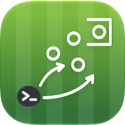

<p align="center">
  
</p>

# Shep

Shows and controls the terminals and coding agents that [herdr-core](https://github.com/herdrdev/herdr-core) keeps alive.

- **Spaces, tabs and panes.** A space has the tabs of one project. A tab has one terminal, or
  terminals side by side and one above the other.
- **Agents.** The sidebar shows each agent and its status: working, done, or needs you. A sound and
  a notification tell you when an agent needs you or stops work.
- **Machines.** Add a computer that you connect to with SSH. Its spaces and agents show with those
  of this Mac. Pause a machine to stop the connection to it, for example
  so that a virtual machine can sleep; resume it when you need it again.
- **Shared with Herdr.** Shep uses the same layout and labels as the
  [Herdr](https://github.com/herdrdev/herdr-app) app. You can open Herdr and Shep on the same
  terminals, and an agent that you saw in one is seen in the other.
- **Native.** Written in Swift for Apple silicon. The terminals stay alive in herdr-core when Shep
  quits.

Shep does the job of Herdr, which gave the idea, without its mods, layouts and themes. The terminal
emulation is [libghostty-vt](https://ghostty.org) from the Ghostty project.

## Install

Needs a Mac with Apple silicon, macOS 26 or later, and herdr-core:

```sh
curl -fsSL https://releases.herdr.dev/core/install.sh | sh
```

Shep has no release yet. See [Build](#build).

## Use

- **New Space** (Command-N) makes a space in your home folder. **New Space in Folder…**
  (Shift-Command-N) asks for the folder.
- **New Tab** is Command-T. **Split Right** is Command-D and **Split Down** is Shift-Command-D.
- Command-W closes the tab and Shift-Command-W closes the pane. Their terminals stop.
- Command-1 to Command-9 select a tab. Control-1 to Control-9 select a space.
- Command-[ and Command-] go to the previous and the next agent.
- **Command Palette…** (Shift-Command-P) shows all commands and their keys.
- Right-click a space or a tab to rename it or close it. Right-click an agent to pin it or to mark
  it as unread.
- **Settings…** has the font size, the alerts, the machines, and the path of the `hc` command.

## How it works

Shep starts `hc connect` and speaks the herdr-core protocol on it. herdr-core owns the terminals;
Shep attaches to their output and sends your keys. The layout of spaces, tabs and panes is the
herdr-core document `herdr-app`, the same one that Herdr writes. Shep changes only the fields that
it knows and keeps all others. If Herdr and Shep change the layout at the same time, the first
write wins and the other app reads the layout again.

## Build

```sh
brew install xcodegen
echo 'DEVELOPMENT_TEAM = <your team ID>' > Local.xcconfig
xcodegen generate
open Shep.xcodeproj
```

Swift Package Manager downloads the precompiled libghostty-vt (release `vt-1.0.1`) and checks its
checksum. `./test.sh` runs the tests.

## License

MIT. See [LICENSE](LICENSE). Notices for the software of other people are in
[THIRD_PARTY_NOTICES.md](THIRD_PARTY_NOTICES.md).
